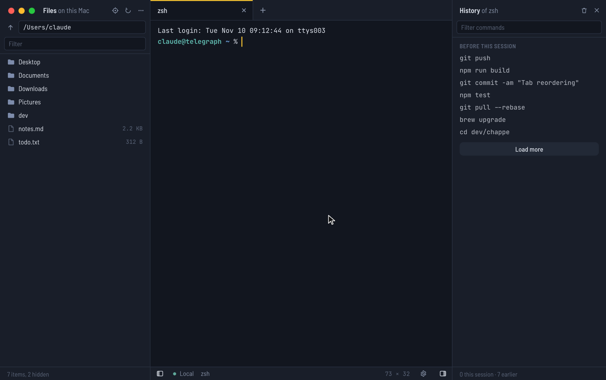

# Chappe

A terminal and SSH client for macOS, Linux and Windows. Local shells and
servers open side by side in tabs, each with its files, a text editor and its
command history within reach.

Named after Claude Chappe, who built the optical telegraph: the first network
for sending messages over long distances, tower to tower.

## At a glance

- **One palette for every session.** Local shells, saved servers and the hosts
  of `~/.ssh/config` in a single searchable list.
- **Files next to the terminal.** The file panel follows the active tab: this
  computer for a local shell, the server over SFTP for an SSH tab.
- **A built-in editor.** Open, edit and save local and remote text files
  without leaving the app.
- **Command history.** Every command run in a tab, ready to run again, with
  nothing to set up in the shell.
- **SSH as you already use it.** The agent, your keys, jump hosts and
  `known_hosts` work as they do with `ssh`.
- **Themes and fonts.** Light and dark themes for the terminals, the editor
  and the whole interface.
- **Automatic updates.**

## Download

Installers are on the [releases page](https://github.com/Modship/chappe/releases/latest):

- **macOS**: `.dmg`, for Apple silicon and Intel
- **Windows**: `.msi` or `.exe`
- **Linux**: `.deb`, `.rpm` or `.AppImage`

The builds aren't code-signed yet, so macOS and Windows warn before opening
them. On macOS, right-click the app and choose Open (macOS 15 and later:
System Settings › Privacy & Security › Open Anyway). On Windows, choose
More info › Run anyway.

## Sessions

The + button in the tab bar, or ⌘T (Ctrl+Shift+T elsewhere), opens the session
palette: every local shell and server in one searchable list, the most recently
used first. Type a few letters of a name or an address, then press Enter. The
first nine entries also open with ⌘1…⌘9 (Alt+1…Alt+9 elsewhere).

Typing `user@host:port` connects to a server that isn't saved. ⌘E (Ctrl+E)
edits the selected server, and "Add a server…" closes the list.

Right-clicking a tab offers Close, Close Others, Close Tabs to the Right, Close
Tabs to the Left and Close All. Editors with unsaved changes among them ask
first; a middle-click closes a tab. Dragging a tab along the bar reorders it.

## Local terminals

On macOS and Linux, a local tab runs your login shell, so `.zprofile`,
`.zshrc` or `.bash_profile` load as they would in any terminal.

On Windows, the session palette lists PowerShell 7 (when installed), Windows
PowerShell, Command Prompt and every WSL distribution. The first one is the
default for new tabs.

## SSH

The session palette lists two kinds of servers:

- **Saved servers**, added with the + button. They are stored in
  `servers.json` in the app's config folder
  (`~/Library/Application Support/dev.chappe.app/` on macOS).
- **Hosts from `~/.ssh/config`**, read live. `HostName`, `User`, `Port`,
  `IdentityFile`, `ProxyJump` and `Include` are honoured; `Host *` blocks
  provide defaults and are not listed. Edit one to save a copy you can change.

Authentication follows `ssh`: the SSH agent, then key files, then
keyboard-interactive and password. Encrypted keys ask for their passphrase.
Passwords can be remembered in the macOS Keychain, the Windows Credential
Manager or the Linux keyring; they are never written to `servers.json`.

Host keys are checked against `~/.ssh/known_hosts` (hashed entries, wildcards
and `@revoked` included). A new host asks for confirmation and is added to the
file; a changed key refuses the connection and says how to fix it.

## Files

The panel on the left follows the active tab: the files of this computer for a
local shell, the server's files over SFTP for an SSH tab. SFTP runs on the
tab's own connection, so it never asks for a password again.

- Double-click or Enter opens a folder, or a text file in the editor. Other
  files open in their default app (remote ones from a temporary copy, so
  changes made there are not sent back).
- Right-click for download, upload, rename, delete, copy path and "Open in
  terminal", which `cd`s the shell there.
- Drop files from the Finder or Explorer onto the panel to upload them.
- The target button takes the panel to the shell's current folder. Shells that
  report their folder (OSC 7) are followed automatically.
- Local deletes go to the Trash. Remote deletes are permanent and ask first.
- ⌘B (Ctrl+Shift+B) shows or hides the panel; its edge can be dragged.

## Find in the terminal

⌘F (Ctrl+Shift+F elsewhere) opens a find bar over the terminal; it searches
the output and the whole scrollback, from the latest output up. Matches are
highlighted as you type, with their count and marks in the scrollbar. Enter
(or ⌘G) goes up to older matches, Shift+Enter (or ⇧⌘G) back down; Aa, ab and
.* switch on match case, whole word and regular expressions; Esc closes the
bar. A one-line selection becomes the search.

## Editor

Text files open in an editor tab: double-click one in the file panel, or
right-click it and choose Edit. Images, PDFs, archives and other binary files
open in their default app instead.

- Remote files are read and saved over SFTP, on the tab's connection.
- ⌘S (Ctrl+S) saves. If the file changed on disk or on the server since it was
  opened, Chappe asks before replacing it.
- ⌘F (Ctrl+F) finds and replaces; ⌘⌥G (Ctrl+Alt+G) goes to a line.
- Syntax highlighting follows the file name, for about a hundred languages.
- Line endings (LF or CRLF) and a UTF-8 byte order mark are kept as they were.
- Closing a tab or quitting with unsaved changes asks first.
- Files up to 5 MB, in UTF-8.

## History

The panel on the right lists the commands run in the active terminal tab.

- Commands are read from the screen when Enter is pressed, so lines recalled
  with ↑ or completed with Tab are listed as they ran. Nothing needs to be set
  up in the shell. Shells that mark their prompts (OSC 133, from iTerm2 or
  VS Code shell integration) are followed exactly.
- Left out: full-screen programs (vim, less, top), input a program doesn't
  echo (passwords), lines typed for a program rather than the shell, and
  commands starting with a space.
- "Before this session" lists the last 20 commands the shell ran earlier, read
  from its own history file (zsh, bash, fish, PowerShell); "Load more" reads
  older ones. Over SSH the file is read on a separate channel of the tab's
  connection: nothing appears in the terminal.
- Click to select, double-click or ⌘↵ (Ctrl+↵) to run, Enter to insert in the
  terminal without running. A command isn't run over something already typed.
- The history lives in memory only: it is never written to disk, and goes
  away with the tab.
- ⇧⌘H (Ctrl+Shift+H) shows or hides the panel; its edge can be dragged.

## Settings

⌘, (Ctrl+, elsewhere), the cog in the status bar, or Chappe › Settings… on
macOS opens the settings tab. Changes apply right away to every open terminal
and editor, and are saved in `settings.json` in the app's config folder.

- Theme: Chappe Dark and Light, Solarized Dark and Light, Dracula, Nord,
  Gruvbox Dark, One Dark, Tokyo Night, Catppuccin Mocha and Latte. A theme
  colours the terminals, the editor and the whole interface.
- Terminal font: JetBrains Mono, Fira Code, Source Code Pro and IBM Plex Mono
  are included; common monospace fonts installed on the computer are listed
  too, and any other installed font can be typed in. Installed Nerd Fonts fill
  in the icons a font lacks.
- Interface font (Barlow Semi Condensed, Inter, the system font or an
  installed one) and text size. Paths and commands in the panels use the
  terminal font.
- Font size, line height, cursor shape and blinking (new tabs), scrollback.
- Editor font size.

## Shortcuts

| Action | macOS | Linux / Windows |
| --- | --- | --- |
| New session | ⌘T | Ctrl+Shift+T |
| Show or hide files | ⌘B | Ctrl+Shift+B |
| Show or hide history | ⇧⌘H | Ctrl+Shift+H |
| Settings | ⌘, | Ctrl+, |
| Find in terminal | ⌘F | Ctrl+Shift+F |
| Save (editor) | ⌘S | Ctrl+S |
| Find (editor) | ⌘F | Ctrl+F |
| Close tab | ⌘W | Ctrl+Shift+W |
| Next / previous tab | ⌘⇧] / ⌘⇧[ or Ctrl+Tab | Ctrl+PgDn / Ctrl+PgUp or Ctrl+Tab |
| Go to tab 1 to 9 | ⌘1 … ⌘9 | |
| Copy / paste | ⌘C / ⌘V | Ctrl+Shift+C / Ctrl+Shift+V |
| Open a link | ⌘-click | Ctrl-click |

In the file list: arrows to move, Enter to open, Backspace for the parent
folder, F2 to rename, Delete (⌘⌫ on macOS) to delete, and typing jumps to a name.

On Windows, Ctrl+C also copies when text is selected (and interrupts when
nothing is), and Ctrl+V pastes, as in Windows Terminal.

## Updates

Chappe updates itself: it looks for a new version a few seconds after launch
and every six hours (Settings › Updates can turn this off or check now). A
newer version shows "Update to x.y.z" in the status bar; installing it
downloads the new build, checks its signature and restarts the app.

The updater replaces the app itself on macOS, the AppImage on Linux and the
installed app on Windows. Linux `.deb` and `.rpm` installs update through
their package manager instead.

## Coming next

- Tunnels and port forwarding
- Profiles: custom shells, startup commands
